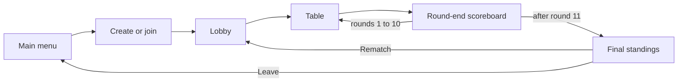
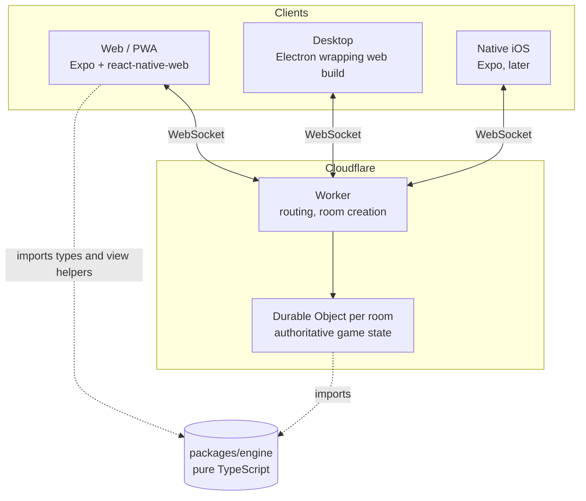
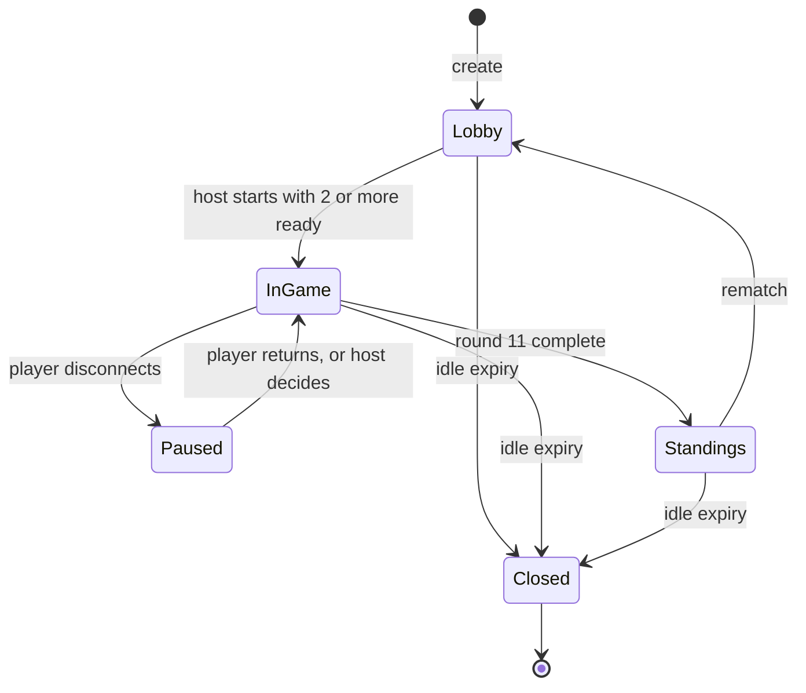

# Five Kingdoms: Software Design Document

Status: draft for owner review. Related: [rules](rules.md), [glossary](GLOSSARY.md), [ADRs](adr/).

## 1. Overview & goals

Five Kingdoms is an online, real-time multiplayer version of the card game Five Crowns, built for the owner's family and friends. The table experience is inspired by Ubisoft's online UNO game (private rooms, avatars around a table, lively animations, quick emotes), but all art and assets are original.

Goals for v1:

- Friends join a private room with a short code and play a complete, correct 11-round game together.
- It feels good: smooth deal/draw/discard animations, sound, emotes, a clear scoreboard.
- It is free or near-free to host.
- It runs on iPhone (as a PWA), and on macOS and Windows (Electron), from one TypeScript codebase.
- The rules engine is correct, well tested, and reusable by client and server.

## 2. Non-goals for v1

- Public matchmaking and pass-and-play.
- Async (multi-day) games. Live sessions only.
- Bots as a product feature. A simple bot exists only as a test tool.
- Accounts, profile customization, stats, text chat, voice.
- House rules (the engine is designed for them, but only official rules ship).
- Native iOS and Android apps, and store publishing.
- Portrait layouts.
- More than 7 seats (8 may come later as a house rule).

## 3. Users & scenarios

Users are a small, known group: family and friends, mixed ages, mostly on phones plus some laptops. No one needs an account.

| Scenario           | Flow                                                                                                                                               |
| ------------------ | -------------------------------------------------------------------------------------------------------------------------------------------------- |
| Host starts a game | Open the app, set name and avatar (remembered on the device), create a room, share the room code, wait in the lobby, start when everyone is ready. |
| Friend joins       | Open the app or web link, enter the room code, set name and avatar, ready up.                                                                      |
| Playing a round    | Take turns drawing and discarding, with animations. Whoever goes out triggers final turns, then the scoreboard.                                    |
| Someone drops      | Game pauses about 60 s. If they return, they resume the same seat. Otherwise the host picks an option (section 9.4).                               |
| End of game        | Final standings with a Rematch button that returns everyone to the lobby with the same room.                                                       |
| Coming back later  | Name and avatar are remembered. Rejoin a live room with its code.                                                                                  |

## 4. Rules summary

Full, numbered, testable rules are in [rules.md](rules.md). In brief:

- 116 cards (two 58-card decks, 3 Jokers each). 2 to 7 players. 11 rounds.
- Round _n_ deals _n_ + 2 cards. The wild rank equals the hand size (3s in round 1, up to Ks in round 11). Jokers are always wild.
- A turn is draw one, discard one. Books (3+ of a rank) and runs (3+ consecutive, same suit, no wrap) use wilds as substitutes.
- A player who can meld their whole hand except one card goes out. Everyone else gets one final turn and may lay down melds. No laying off.
- Others score unmelded cards (3 to 10 face, J 11, Q 12, K 13, wild rank 20, Joker 50). Lowest total after 11 rounds wins, ties share.

Four interpretations are ours, flagged in rules.md and listed in section 16: all-wild melds, discard reshuffle on exhaustion, natural wild-rank cards used as themselves, and player-arranged final-turn melds with a solver assist.

## 5. UX flow & screens

Landscape only on every device ([ADR 0006](adr/0006-landscape-only.md)).

### 5.1 Screens

| Screen               | Contents                                                                                                                                                                                                                                            |
| -------------------- | --------------------------------------------------------------------------------------------------------------------------------------------------------------------------------------------------------------------------------------------------- |
| Main menu            | Name and avatar picker (remembered on device), Create room, Join room (code entry), settings (sound).                                                                                                                                               |
| Create / join        | Create: choose max seats (2 to 7) and options (turn timer on/off). Join: enter the short room code.                                                                                                                                                 |
| Lobby                | Room code with copy/share, players with avatars and ready state, host-only room settings and Start (needs at least 2 players, all ready).                                                                                                           |
| Table                | Players with avatar, name, and card count around the table. Draw pile and discard pile in the center. Own hand along the bottom. Round number and highlighted wild rank. Meld action when allowed. Emote button. Turn indicator and optional timer. |
| Round-end scoreboard | Per-player round score, running totals, who went out, revealed melds and leftover cards. Continue (all players acknowledge or short timeout).                                                                                                       |
| Final standings      | Ranked totals, winners highlighted (ties share), Rematch and Leave.                                                                                                                                                                                 |

### 5.2 Table interactions

- Draw by tapping/clicking the draw pile or the top discard.
- Select a card, then discard (tap the discard pile or a Discard button). Drag and drop is a nice-to-have.
- When going out or on a final turn, the player gets an arrange-melds mode. The engine solver offers Auto-arrange and a hint (see section 8.4).
- About 8 quick emotes, shown as a bubble near the sender's avatar. No free-text chat in v1.
- Optional per-turn timer, toggled by the host in room settings. On expiry, the server plays an automatic draw-from-draw-pile and discards the drawn card (open question 8).

### 5.3 UI/UX reference

> **TODO: awaiting the owner's references.** The owner will provide Ubisoft UNO screenshots. When they arrive, this section will be filled with annotated notes on layout, hierarchy, motion, and interaction patterns to borrow (never art or assets).
>
> Expected flow, to be validated against the screenshots: main menu → create/join → lobby → table → round-end scoreboard → final standings.

## 6. Visual design direction

- Card theme **Five Kingdoms**: each of the five suits is a kingdom with its own colorblind-safe color and a crest that contains the classic suit symbol (stars, hearts, diamonds, clubs, spades). The classic symbol keeps cards readable at a glance, and color is never the only signal.
- Large rank numerals for readability on phones held in landscape.
- The current round's wild rank is visually highlighted on every card of that rank and in the round header. Jokers have a distinct, original design.
- Cards, table, and UI are drawn in code as SVG for the MVP ([ADR 0008](adr/0008-svg-in-code-art.md)). Sound effects are free CC0 packs.
- Palette: to be defined in a design-tokens module with a colorblind check for the five kingdom colors (research task, see risks).
- All art and assets are original. No UNO or Ubisoft assets.

## 7. Architecture

### 7.1 Monorepo layout

pnpm workspace, all TypeScript ([ADR 0001](adr/0001-pnpm-monorepo.md)).

| Path                | Role                                                                                                                                                          |
| ------------------- | ------------------------------------------------------------------------------------------------------------------------------------------------------------- |
| `packages/engine`   | Shared pure rules engine. No I/O, no clocks, no platform APIs.                                                                                                |
| `packages/protocol` | WebSocket message types shared by client and server, plus `PROTOCOL_VERSION`.                                                                                 |
| `apps/client`       | Expo + React Native + react-native-web: one UI codebase for web, desktop (via web build) and iOS ([ADR 0002](adr/0002-react-native-and-react-native-web.md)). |
| `apps/server`       | Cloudflare Worker plus a Durable Object class per room, WebSockets ([ADR 0004](adr/0004-cloudflare-durable-objects.md)).                                      |
| `apps/desktop`      | Electron shell loading the built web client ([ADR 0003](adr/0003-web-pwa-and-electron-mvp.md)).                                                               |

### 7.2 Key principles

- **Server authoritative.** Clients send intents and receive redacted views plus events. A client only ever sees its own hand and the other players' card counts ([ADR 0005](adr/0005-server-authoritative-shared-engine.md)).
- **One room, one Durable Object.** All players of a room connect to the same DO, which serializes actions without locks.
- **Engine shared, not trusted.** Clients may import the engine for UI help (legal-move hints, meld validation preview), but the server always re-validates.

## 8. Engine design

`packages/engine` is a pure TypeScript package with no runtime dependencies on the platform. This section describes responsibilities, not signatures.

### 8.1 Responsibilities

- Model cards, decks, hands, melds, rounds, scores, and game config.
- Validate and apply player actions according to [rules.md](rules.md).
- Produce events that describe what happened, for animation and logging.
- Produce redacted views per player.
- Provide a meld solver.
- Provide a seeded PRNG for shuffles.

### 8.2 The reducer

The core is a pure reducer: `(state, action) → { state, events }`.

- The same state and action always yield the same result. No clocks, randomness or I/O inside, apart from the seeded PRNG whose state lives inside `state`.
- Invalid actions return a typed rejection without changing state, so the server can answer with an error.
- The reducer is config-driven (deck composition, rounds, hand sizes, wild rules, scoring table, seat limits). Official rules are the default config. House rules later are extra config, not forks ([ADR 0005](adr/0005-server-authoritative-shared-engine.md)).
- Actions cover the game only (start game, draw, discard, go out, final-turn melds, advance round). Room concerns (ready, kick, pause) live in the server.

### 8.3 Redacted per-player views

- A view function turns the full state into what one seat may see: own hand, others' card counts, discard top, draw pile count, melds laid down after the round ends, scores.
- Hidden information (other hands, draw pile order, PRNG state) never leaves the server.
- Events are redacted the same way. For example, an opponent drawing from the draw pile is sent as "drew a card" without its identity. A draw from the discard pile is public, because everyone sees the card.
- Redaction is a separate, heavily tested module, because it is the main cheating and privacy boundary.

### 8.4 Meld solver

- Given a hand and the round's wild rank, the solver finds arrangements of melds that minimise the leftover points. For going out it checks whether all but one card can be melded.
- Handles books, runs, wilds, all-wild melds, and natural wild-rank cards used as themselves (interpretations 1 and 3).
- Used by: the server to validate a submitted arrangement (cheap check); the client for hints and Auto-arrange; the test bot to decide when to go out.
- Hands are at most 14 cards, so an exact search with pruning is fast enough; performance is verified with property tests on large hands.

### 8.5 Seeded PRNG

- Every game has a seed. Shuffles (initial and mid-round reshuffles) consume the PRNG deterministically.
- Given a seed and an action log, any game can be replayed exactly. This powers bug reports and golden-game tests.
- The server picks the seed with a secure random source, and never reveals it during a game.

### 8.6 Test bot

A simple bot (draws, discards the highest unusable card, goes out when the solver says so) lives with the engine tests as a tool for simulation and fuzzing. It is not a product feature in v1.

## 9. Networking protocol

Transport: WebSocket per player to the room's Durable Object, JSON messages. The schema lives in code, in its own package, `packages/protocol` (`src/messages.ts`). It exports `PROTOCOL_VERSION`, which `join` must carry; the server rejects other versions.

### 9.1 Message types

| Direction       | Type               | Purpose                                                                                                                                                                                                                                                   |
| --------------- | ------------------ | --------------------------------------------------------------------------------------------------------------------------------------------------------------------------------------------------------------------------------------------------------- |
| Client → server | `join`             | Join a room with code, display name, avatar, protocol version, and optionally a device-held rejoin token.                                                                                                                                                 |
| Client → server | `ready`, `unready` | Lobby ready state.                                                                                                                                                                                                                                        |
| Client → server | `settings`         | Host changes room settings. Only max seats (2 to 7) exists so far; the turn timer is not built yet.                                                                                                                                                       |
| Client → server | `start`, `rematch` | Host starts a game or a rematch.                                                                                                                                                                                                                          |
| Client → server | `intent`           | A game action (draw, discard, go out, final-turn melds) plus the last view version the client has seen. The server-driven `startNextRound` is not a valid intent.                                                                                         |
| Client → server | `continue`         | Acknowledges the round-end scoreboard. Once every connected player has sent it, the server starts the next round.                                                                                                                                         |
| Client → server | `emote`            | One of about 8 canned emotes.                                                                                                                                                                                                                             |
| Client → server | `hostDecision`     | After a disconnect grace period: `wait` or `skip`. Bot handover is not built yet.                                                                                                                                                                         |
| Client → server | `ping`             | Heartbeat. A plain `ping` string, not JSON.                                                                                                                                                                                                               |
| Server → client | `welcome`          | Seat, room info, current redacted view (`null` in the lobby), version, and the rejoin token on a first join only. While the table is at the scoreboard or game over it also carries `lastRoundScored`, so a reconnecting player can see the round result. |
| Server → client | `roomUpdate`       | Lobby changes: players, ready state, settings, host.                                                                                                                                                                                                      |
| Server → client | `events`           | Ordered game events (redacted), plus the new view version.                                                                                                                                                                                                |
| Server → client | `view`             | Full redacted view for resync (reconnect or detected gap).                                                                                                                                                                                                |
| Server → client | `error`            | A rejected intent or protocol error, with a code.                                                                                                                                                                                                         |
| Server → client | `presence`         | Player connected, disconnected (with deadline), or returned.                                                                                                                                                                                              |
| Server → client | `pong`             | Heartbeat reply, a plain string answered by the runtime without waking the Durable Object.                                                                                                                                                                |

### 9.2 Intent handling

1. Client sends an `intent` with the last view version it knows (`lastVersion`).
2. The DO checks that the sender owns the seat and it is their turn, then runs the engine reducer.
3. On success, the DO persists state, then broadcasts the redacted `events` and a version bump to each player.
4. On failure, only the sender gets an `error` (code `ENGINE`, carrying the engine's own code). State is unchanged. If `lastVersion` was behind, the sender also gets a full `view`.

Clients animate from events and reconcile against the view. If a client's version has a gap, the server sends a full `view`.

### 9.3 Room lifecycle

- Room codes are 5 characters from an unambiguous alphabet (no `0 O 1 I L`). The Worker proposes a code and retries with a new one if that room already exists.
- A room lives while anyone is connected, plus 30 minutes (a Durable Object alarm). After that, state is deleted.
- Joining is allowed only in the lobby (new players). Mid-game joins are rejoin only.
- There is no Leave message yet. Leaving just disconnects and keeps the seat.
- The host sends `rematch` from the final standings; the room returns to the lobby with the same seats, all unready.

### 9.4 Disconnects and reconnect

1. On disconnect, the game **pauses** and a deadline of about 60 s starts. All players see who is gone and the countdown.
2. If the player returns within the grace period (same rejoin token, same room code), they resume their seat and the game continues.
3. If not, the **host** chooses with `hostDecision`: `wait` (extend the deadline by another 60 s) or `skip`. Handing the seat to the simple bot is planned but not built yet.
4. Skipping means an automatic draw-from-draw-pile and discard for each of that player's turns. Skipped players play normally when they return. When bot handover is built it will reuse the test bot, and the player can reclaim the seat by returning (open question 7).
5. Reconnect always sends a fresh `welcome` with the full redacted view, so clients never rely on missed events.

Identity at the socket level is the rejoin token, a random secret stored on the device and bound to a seat when joining. The server returns it only on the first join and stores only its SHA-256 hash; a rejoin with a valid token gets the same seat and no new token. It is not an account.

### 9.5 Optional turn timer

**Not built yet.** When the host enables it, the DO will set an alarm per turn. On expiry, the server will play the default action for that player. The timer is paused during a disconnect pause.

## 10. Data and state

| Data                                                      | Where it lives                                                   | Lifetime                                  |
| --------------------------------------------------------- | ---------------------------------------------------------------- | ----------------------------------------- |
| Game state (full, unredacted, including PRNG state)       | Durable Object memory, persisted to DO storage after each action | Room lifetime, deleted at expiry          |
| Room settings, seats, ready state, rejoin tokens (hashed) | Durable Object storage                                           | Room lifetime                             |
| Redacted view                                             | Derived on demand, sent to clients, held in client memory        | Per connection                            |
| Name, avatar, rejoin token(s)                             | Device storage (localStorage on web, AsyncStorage on native)     | Until cleared                             |
| Sound and UI preferences                                  | Device storage                                                   | Until cleared                             |
| Accounts, stats, history                                  | Not in v1                                                        | Later, requires a database (D1 candidate) |

Notes:

- The server is the single source of truth. Clients hold no authoritative game state.
- Persisting to DO storage after every action makes rooms survive Durable Object eviction and restarts. Hibernation-friendly WebSockets are preferred so idle rooms cost nothing (to be confirmed by the free-tier research task).
- No personal data beyond a chosen display name and avatar is stored, and nothing is stored after the room expires.

## 11. Platforms & distribution

Private distribution to friends and family. Store publishing is out of scope.

| Platform   | Approach                                                                                   | Cost                           | Notes                                                                  |
| ---------- | ------------------------------------------------------------------------------------------ | ------------------------------ | ---------------------------------------------------------------------- |
| Web / PWA  | Expo web export hosted on Cloudflare Pages (candidate). iPhone users "Add to Home Screen". | Free                           | MVP primary target.                                                    |
| macOS      | Electron wrapping the web build                                                            | Free                           | Unsigned for now: users must approve it in Gatekeeper on first launch. |
| Windows    | Electron wrapping the web build                                                            | Free                           | Unsigned for now: SmartScreen warning on first launch.                 |
| iOS native | Expo build via TestFlight                                                                  | $99/yr Apple Developer Program | Deferred until the owner pays. Tested in the iOS simulator meanwhile.  |
| Android    | Expo build                                                                                 | Later                          | After the MVP. Avoid iOS-only choices in the meantime.                 |

Before any public release: do a trademark check on the name. "Five Crowns" is a Set Enterprises / PlayMonster trademark, and "Five Kingdoms" must be checked for conflicts and for being confusingly similar.

Reasoning is in [ADR 0003](adr/0003-web-pwa-and-electron-mvp.md).

## 12. Testing strategy

| Layer             | Approach                                                                                                                                                                                              |
| ----------------- | ----------------------------------------------------------------------------------------------------------------------------------------------------------------------------------------------------- |
| Engine unit tests | Every numbered rule in rules.md maps to at least one test. Table-driven scoring tests, meld validity and solver cases (wilds, all-wild melds, natural wild rank).                                     |
| Property tests    | Invariants from rules.md section 11 (card conservation, round terminates, scores bounded) over random seeded games played by the test bot. Solver agrees with a brute-force reference on small hands. |
| Golden games      | Recorded seed plus action log gives an exact expected event stream and final scores.                                                                                                                  |
| Redaction tests   | For many states, a seat's view and events never contain other hands or draw pile order.                                                                                                               |
| Server tests      | Room lifecycle, intent ordering, disconnect and reconnect, alarms, using Workers test tooling (for example Miniflare). Protocol tests with scripted clients.                                          |
| Client tests      | Component tests for cards and table layouts, snapshot tests of SVG cards, accessibility checks (contrast, colorblind simulation).                                                                     |
| End-to-end        | A scripted multi-client game against a local server for smoke testing. Manual play-testing sessions with the family before each milestone.                                                            |
| Platform checks   | iPhone Safari PWA, macOS and Windows Electron, and iOS simulator manual checklists.                                                                                                                   |

## 13. CI & workflow

- One GitHub PR per feature, into `main`.
- GitHub Actions CI runs on every PR: typecheck, lint, format check, and tests (all packages via pnpm workspaces).
- Conventional commit messages (`feat:`, `fix:`, `docs:`, and so on).
- Docs changes (like this one) go through the same PR flow. ADRs are added or superseded rather than rewritten.
- Desktop and web build jobs are added as those apps arrive. No deploy automation is committed to until hosting is verified.

## 14. Milestones

No hard date. Stretch goal: a rough playable web version by winter break.

| #   | Milestone                                | Done when                                                                                                             |
| --- | ---------------------------------------- | --------------------------------------------------------------------------------------------------------------------- |
| 1   | Rules engine, fully tested               | All rules in rules.md covered by tests, solver, redaction and simulated games passing in CI.                          |
| 2   | Server rooms + bare-bones playable table | Create/join by code, lobby, play a full 11-round game with friends on web, with reconnect handling.                   |
| 3   | UNO-style UI polish                      | Animations, sound effects, emotes, scoreboard, final standings, Rematch, optional turn timer, Five Kingdoms card art. |
| 4   | Desktop apps                             | Electron builds for macOS and Windows distributed privately.                                                          |

Status: milestones 1 and 2 have a working proof of concept in PRs #1, #4, #5 and #6, which target `dev`.

After the milestones: native iOS (TestFlight), Android, then the "later" list: text chat, voice, profile customization, stats, accounts, async play, house rules, bots.

## 15. Risks

| Risk                                                                                               | Impact                                                  | Mitigation                                                                                                                                   |
| -------------------------------------------------------------------------------------------------- | ------------------------------------------------------- | -------------------------------------------------------------------------------------------------------------------------------------------- |
| Cloudflare free-tier limits (requests, duration, storage, WebSocket messages) are not yet verified | Hosting could cost money or throttle                    | A research task verifies current limits. Design for few, small messages and hibernation. Keep the server thin so it can move hosts.          |
| Landscape-only cannot be enforced on iPhone PWAs                                                   | Portrait users see a broken layout                      | Show a "rotate your device" overlay. Orientation lock works in Electron and native, not reliably in iOS Safari/PWA (see section 16, note A). |
| iOS PWA quirks (audio unlock, WebSocket suspension in the background, no push)                     | Missed turns, silent sound                              | Require a tap before audio. Treat backgrounding as a disconnect with fast rejoin.                                                            |
| One RN codebase across web, desktop and iOS                                                        | Web layout and animation performance differ from native | Keep animations simple, test on all targets early (milestone 2), and use Reanimated only where proven on web.                                |
| Rules ambiguity                                                                                    | Players dispute outcomes                                | Four interpretations are written down and approved by the owner before engine finalization.                                                  |
| Unsigned desktop apps                                                                              | Install friction                                        | Document the steps for friends. Revisit signing if it becomes a real issue.                                                                  |
| Name and trademark ("Five Crowns")                                                                 | Blocks a public release                                 | Trademark check before any public release. Private use is unaffected.                                                                        |
| Solver complexity with many wilds in large hands                                                   | Slow auto-arrange                                       | Exact search with pruning and a time budget, backed by property tests.                                                                       |
| Cheating by modified clients                                                                       | Unfair private games                                    | Server authority and redaction make it very hard. Fully fair play among friends is the stated scope.                                         |
| Colorblind-safe palette for five suits plus the Joker                                              | Hard to tell kingdoms apart                             | Crest shape plus classic symbol plus color. Test with simulation tools.                                                                      |

## 16. Open questions for the owner

**All questions in this section were accepted by the owner on 2026-11-11, with the defaults shown.**

### 16.1 Rules interpretations

These are our interpretations, marked in [rules.md](rules.md). The engine implements the defaults.

| #   | Question                                                                                   | Our default                                                                      |
| --- | ------------------------------------------------------------------------------------------ | -------------------------------------------------------------------------------- |
| 1   | May a meld consist entirely of wild cards?                                                 | Yes (rule 6.3.4).                                                                |
| 2   | When the draw pile empties, what happens?                                                  | Reshuffle the discard pile except its top card into a new draw pile (rule 10.1). |
| 3   | May a natural card of the wild rank be used as itself (for example a 7 as a 7 in round 5)? | Yes (rule 6.3.5).                                                                |
| 4   | Who arranges melds on final turns?                                                         | The player does, with an engine auto-arrange and hint (rule 8.4).                |

### 16.2 Further gaps (accepted)

| #   | Question                                                                             | Our default                                                                                    |
| --- | ------------------------------------------------------------------------------------ | ---------------------------------------------------------------------------------------------- |
| 5   | May a player discard the same card they just took from the discard pile?             | No (rule 5.7).                                                                                 |
| 6   | Who deals first in round 1?                                                          | Random, seeded (rule 4.1).                                                                     |
| 7   | When a bot takes over a seat after a disconnect, may the original player reclaim it? | Yes, at the start of their next turn.                                                          |
| 8   | What does a skipped turn or an expired turn timer do?                                | Automatically draw from the draw pile and discard the drawn card.                              |
| 9   | If the host disconnects, who makes the host decisions?                               | The host role passes to the next connected player in seat order; all game state is unaffected. |
| 10  | Rematch: keep seats and room code, reset scores?                                     | Yes. Dealer of round 1 is chosen again.                                                        |
| 11  | Players in the lobby with fewer than all ready: can the host start anyway?           | No. All connected players must be ready.                                                       |

### 16.3 Contradictions and tensions in the decisions

Reported rather than silently resolved:

- **A. Landscape-only vs iPhone PWA.** iOS Safari and home-screen PWAs do not honour manifest orientation locks, so landscape-only cannot be enforced there. Proposed: a rotate-device overlay plus a layout that is landscape-only by design. Android, Electron and native iOS can lock orientation. Accepted.
- **B. "Max seats 8 as a house rule" vs a 116-card deck.** 8 players at round 11 need 8 × 13 = 104 cards, leaving 12 for the piles. This works but leaves a thin draw pile, so reshuffles will be frequent. Not a v1 issue, noted for later.
- **C. "Free or near-free hosting" vs reliability expectations.** Free-tier Durable Objects may have limits that matter for 7-player rooms. This is pending the research task. If limits bite, the budget needs revisiting.
- **D. "Optional turn timer" vs "pause on disconnect".** We resolved this by pausing the timer during disconnect pauses. Accepted.

### 16.4 Product items still to supply

- UNO reference screenshots (section 5.3).
- Final name and a trademark decision timeline (only needed before any public release).
- Preferences on the card back and table themes, and the avatar set (originals to be drawn in code, so a style direction is enough).
